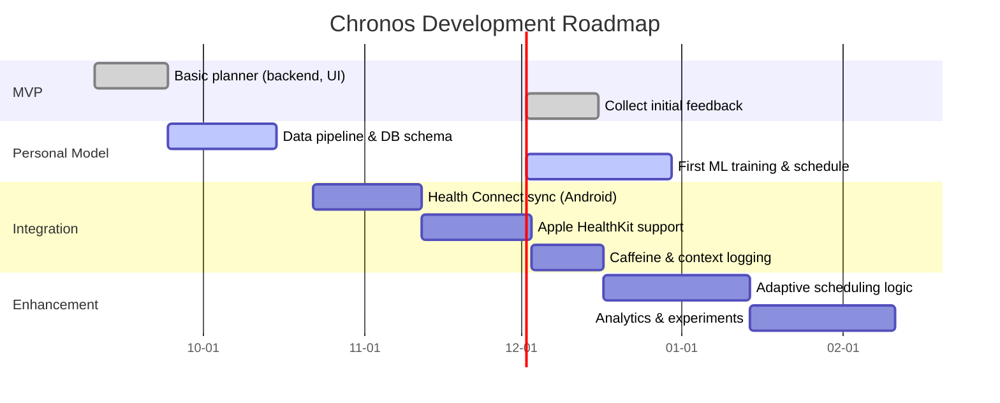
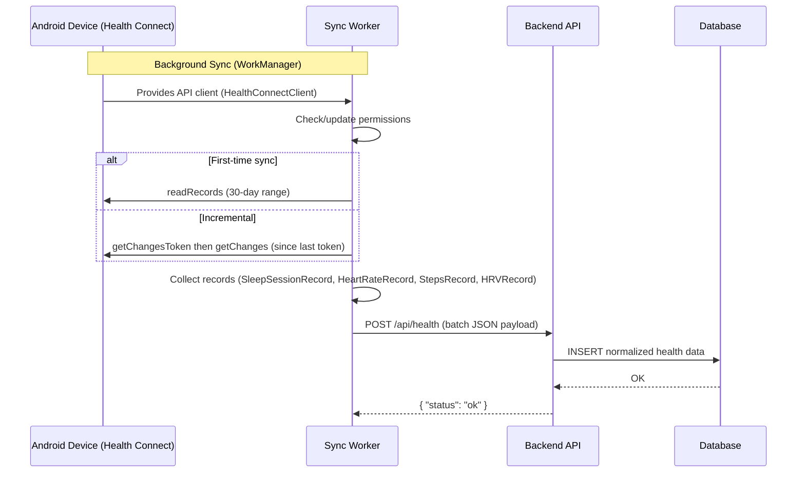
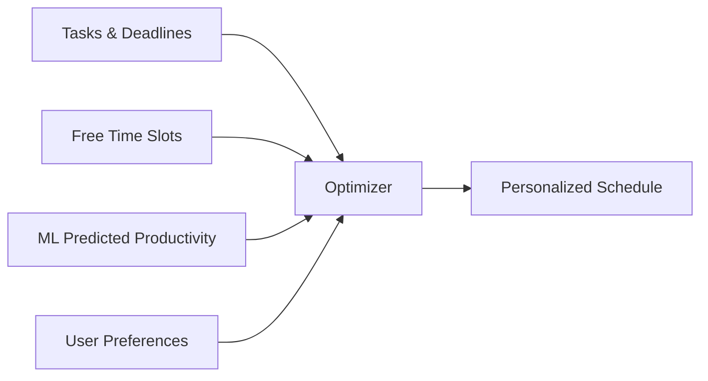

# Chronos – Project Documentation

## Executive Summary  
Chronos is a **personal productivity optimizer** that continuously learns an individual’s patterns and biological state to schedule tasks for maximal cognitive performance.  It collects user data on **sleep**, **activity**, **caffeine intake**, **energy/focus ratings**, and **task outcomes**, and uses machine learning to predict when the user will be most effective at different kinds of work.  Chronos consists of multiple modular components (backend API, data pipelines, biological integrations, ML models, scheduler, frontend UI, infrastructure, privacy controls, and analytics) that work together. This documentation provides a top-level overview and **separate README** guides for each component, covering purpose, inputs/outputs, schemas, APIs, data flows, tech stack, implementation steps, testing, monitoring, and more. It also includes global concerns like **cold-start strategy**, **personalization approach**, **feature engineering** (e.g. sleep/caffeine deltas, HRV baselines), **model choices** (with hyperparameters and metrics), **data/storage options**, and **roadmaps**. 

Key points: Chronos treats the user as a “digital twin” of cognitive state, modeling how **sleep, heart rate/HRV, and routines** affect productivity.  It uses **Health Connect** (Android) and similar APIs to ingest biological data, and allows user input (e.g. manually logged energy or caffeine).  The ML engine (e.g. scikit-learn models) predicts *“expected productivity”* given current state and task features.  The scheduler solves a constrained optimization (maximizing predicted productivity under deadlines/availabilities).  Compliance and privacy are baked in, with GDPR-aligned retention policies.  The system is designed for iterative expansion: the **MVP** (core tasks+calendar+basic ML) can be extended in Phases (data-driven personal model, bio-integrations, adaptive scheduling, experiments).

The documentation is organized by component.  A **folder layout** with concrete file names is given below. Each sub-README (e.g. `backend/README.md`) stands alone and covers its module in detail.  The top-level README (this document) provides an overview and links to each component’s README.

## Architecture & Components  

Chronos has a modular **pipeline architecture**.  At a high level, the flow is:  

1. **User & Mobile App:** User enters tasks, feedback (energy, focus, difficulty, completion) and (optionally) the mobile app collects wearable data (sleep, HR, steps, HRV).  
2. **Backend/API:** A FastAPI backend stores user accounts, tasks, sessions, and ingested data. It exposes REST endpoints for the app and frontend.  
3. **Data Ingestion:** A sync pipeline (e.g. WorkManager on Android) pulls data from Health Connect (sleep, HR, HRV, steps) and posts it to the backend.  
4. **Database:** PostgreSQL (optionally TimescaleDB) stores structured data (tasks, schedules, sessions, health records).  
5. **ML/Personalization:** A Python service trains personalized models (e.g. Random Forest, Gradient Boosting) to predict productivity given features. Models are updated continually as user feedback accumulates.  
6. **Scheduler/Optimizer:** Using the models’ predictions, an optimizer schedules tasks into time slots to maximize expected productivity under constraints (deadlines, availabilities, breaks).  
7. **Frontend/UI:** A web/mobile UI displays the schedule and collects user feedback.  
8. **Analytics/Experiments:** Logging, metrics, and A/B experiments measure performance and allow continuous improvement.  
9. **Privacy/Security:** All personal and health data is encrypted, access-controlled, and subject to strict retention policies (as per GDPR).  

```plaintext
Chronos/
├─ README.md                   ← Top-level overview (this file)
├─ backend/
│   └─ README.md               ← Backend API (FastAPI) docs
├─ data_ingestion/
│   └─ README.md               ← Data collection & sync pipeline docs
├─ biological_integration/
│   └─ README.md               ← Wearable/HealthConnect integration docs
├─ ml/
│   └─ README.md               ← Machine learning / personalization docs
├─ scheduler/
│   └─ README.md               ← Scheduling/optimization docs
├─ frontend/
│   └─ README.md               ← User interface docs
├─ infra/
│   └─ README.md               ← Deployment/infrastructure docs
├─ privacy_security/
│   └─ README.md               ← Privacy/security docs
└─ experiments/
    └─ README.md               ← Analytics/experiments docs
```

### Roadmap & Incremental Phases  

**MVP (Phase 0):** Basic personal planner with tasks, calendar, and manual energy input. Simple scheduling (e.g. greedy insertion by deadline).  Collect user ratings on completed tasks.  

**Phase 1 – Personal Model:** Train ML models on collected feedback to predict productivity from time-of-day, task features, energy, etc. Use predictions to tweak scheduling.  

**Phase 2 – Biological Integration:** Integrate wearable/smartphone data. Sync sleep sessions, heart rate, HRV, steps via Google Health Connect (Android) or Apple HealthKit (iOS). Add these as features (e.g. “hours slept”, “HRV baseline deviation”).  

**Phase 3 – Task/Context Modeling:** Model how task type and context affect performance. Use features like “time since caffeine” (difference between study time and last caffeine) and encode daily routines.  

**Phase 4 – Adaptive Scheduling:** Evolve from static to adaptive: recalc schedule throughout day based on live feedback (e.g. extending or shortening sessions). Include cognitive load balancing and break personalization.  

**Phase 5 – Analytics & Experimentation:** Run N-of-1 experiments (e.g. short vs long break) and A/B tests. Build dashboards of “what Chronos learned” (e.g. peak hours, best routine) for user transparency.  

*Roadmap Timeline (Mermaid Gantt):*  



### Cold-Start and Personalization Strategy  
Chronos addresses the “cold-start” problem by beginning with a **global model** or fallback rules when a new user has no history. For example, it can use population-average productivity curves or ask the user for initial preferences (e.g. best working hours). As the user provides data, Chronos **fine-tunes** or retrains the model on that user’s data. In practice, a hybrid is used: a global model (trained on aggregate data) provides starting predictions, and a per-user model or fine-tuning updates them. Over time, as more sessions and feedback arrive, Chronos’s **confidence** in its personalized model increases and recommendations become highly individualized.  

**Explainability & Confidence:** Every recommendation includes an explanation (e.g. “We scheduled math at 9 AM because your highest analytical scores occur then”). We track model confidence (e.g. data volume, cross-val scores) to avoid overfitting; if confidence is low, fall back on simpler logic. 

## Technology Stack (Summary)  
- **Backend/API:** Python 3.x, FastAPI (for high-performance async REST, automatic OpenAPI docs).  
- **Database:** PostgreSQL (with TimescaleDB extension for time-series).  
- **ML:** Python, scikit-learn, XGBoost/LightGBM (for regression/classification).  
- **Mobile Integration:** Android Health Connect SDK, Apple HealthKit API.  
- **Frontend:** (Unspecified, e.g. React or Flutter) with HTTPS API calls.  
- **Infra/Deployment:** Docker, CI/CD (e.g. GitHub Actions), Kubernetes or cloud (AWS/GCP/Azure).  

We prefer **official, well-supported libraries**:  
  - FastAPI (docs: [28]) for REST services.  
  - Pydantic/SQLAlchemy for data models, Alembic for migrations.  
  - Scikit-learn (models, hyperparam tuning).  
  - Prometheus/Grafana for monitoring (common practice).  
  - OAuth/JWT for authentication (industry-standard).  
  - OpenSSL for TLS and secure storage of keys.

## Data Storage & Integration Options  

**Model Options:**  
| Model Type       | Use Case                  | Example (sklearn/XGBoost)         | Key Hyperparameters              | Pros/Cons                                               |
|------------------|---------------------------|-----------------------------------|----------------------------------|---------------------------------------------------------|
| **Linear Regression** (or Ridge)  | Predict continuous productivity score | `LinearRegression` (sklearn)   | – (few)                        | Simple, interpretable; may underfit nonlinear patterns. |
| **Decision Tree**                | Interpretable model         | `DecisionTreeRegressor`          | `max_depth`, `min_samples_leaf` | Captures nonlinearities; can overfit with high depth.   |
| **Random Forest** (Bagging)      | General-purpose regression/classification | `RandomForestRegressor(n_estimators=100)` | `n_estimators`, `max_depth`     | Good out-of-box; robust; less tuning needed. |
| **Gradient Boosting (XGBoost)**  | High-accuracy regression     | `XGBRegressor()`, `learning_rate`, `n_estimators` | `learning_rate`, `max_depth`     | Often best performance; needs tuning; risk of overfit.  |
| **Neural Network**               | Complex patterns           | e.g. `MLPRegressor(hidden_layer_sizes=(100,50))` | Layers, neurons, LR             | Can model complex functions; requires much data.        |
| **Classifier** (Logistic/GBT)    | If binary task (e.g. done/no-done) | `LogisticRegression()`, `XGBClassifier()` | L2 penalty, learning rate      | For classification metrics (accuracy, F1). |

**Evaluation Metrics:**  
- For regression (predicting continuous productivity/focus): use **MSE/RMSE** (mean squared error, best=0.0), **R²**, or **MAE**.  
- For classification (e.g. success/fail): use **accuracy**, **F1-score**, **ROC-AUC**.  
- Always use cross-validation (e.g. scikit’s `cross_val_score`) to estimate generalization.

**Feature Engineering:** Key features include:  
- **Sleep**: hours last night, sleep efficiency, sleep stage durations (via `SleepSessionRecord`). For example, `sleep_duration` = (end_time – start_time) in hours.  
- **Wake time consistency**: standard deviation of wake-up time over past week.  
- **Caffeine**: record amount & time; compute `minutes_since_caffeine = study_time – last_caffeine_time`. This encoding lets the model learn caffeine lags.  
- **Heart Rate/HRV**: use overnight HRV baseline (average RMSSD) via `HeartRateVariabilityRmssdRecord`. Define feature like `hrv_diff = current_HRV – baseline_HRV`.  
- **Time-of-day & Day-of-week**: encode as cyclical features (sin/cos of hour, one-hot days).  
- **Task characteristics**: difficulty, duration, type (coding, math, reading). Possibly encode with integers or one-hot.  
- **Historical performance**: e.g. recent running average productivity, or previous session outcome.  

**Data Storage Options:**  
| Storage Type         | Technologies         | Use Case / Notes                          |
|----------------------|---------------------|-------------------------------------------|
| **Relational (SQL)** | PostgreSQL          | General data: users, tasks, sessions, feedback. Supports joins and transactions. |
| **Time-series**      | TimescaleDB (Postgres extension) | For high-volume time-series (wearable HR/HRV, steps). Optimized for time-range queries. |
| **NoSQL (Key-Value)**| MongoDB, Redis      | Fast unstructured storage (e.g. caching). Not needed for main data.      |
| **Analytical DB**    | BigQuery, Snowflake | If scaling massive analytics. Possibly future. |
| **Search Index**     | Elasticsearch       | If full-text search needed (task text search). Likely overkill. |
For Chronos, PostgreSQL is primary. TimescaleDB is recommended if we expect large time-series (heart rate, HRV) and want efficient range queries. 

**Integration Options:**  
| Source               | Data Collected              | Integration Ease / Notes                             |
|----------------------|-----------------------------|------------------------------------------------------|
| **Android Health Connect** | Sleep sessions (`SleepSessionRecord`), heart rate, HRV, steps | Standard Android API (Google Play). Supports background sync via WorkManager. Requires user granting permissions. |
| **Apple HealthKit**         | SleepAnalysis (HKCategorySample), HR, HRV, steps   | iOS equivalent. Data access via HealthKit APIs (requires iOS app, permissions). [Apple Dev Docs]. Less open ecosystem than Health Connect. |
| **Wearables (Oura, Whoop, Garmin, etc.)** | Sleep, HRV, Activity | Each has proprietary API/SDK. May require user linking accounts or custom integration. Potential to enrich data. |
| **Browser Extension / PC**  | Activity logs (time on apps/sites), keyboard/mouse input  | Unspecified. Could build a Chrome/Firefox extension or use an existing one (RescueTime API) to measure distractions. Adds context but not privacy-sensitive as health data. |
| **Manual Entry**           | Caffeine intake, subjective energy/mood | Users manually input via app. Necessary fallback for non-automatable data. |
  
In practice, the mobile app will use Health Connect on Android to pull sleep/HR/HRV, and fall back on manual input for caffeine and subjective data. Integration is modular – others (e.g. a browser plugin) can be added later.

## chronos/backend/README.md

**Purpose:** The backend handles **data management and API**. It serves REST endpoints for tasks, users, scheduling, and stores all data. 

**Scope:**  
- User accounts and authentication (e.g. JWT login).  
- CRUD for tasks (DSA problems, lectures, etc.).  
- Logging “study sessions” (task start/end, completion).  
- Recording feedback (energy, focus, difficulty, productivity ratings).  
- Storing synced health data (sleep, HR, HRV, steps).  
- Exposing schedule/planning endpoints (e.g. GET `/schedule`).  

**Inputs/Outputs:**  
- **Inputs:** JSON requests from mobile app or frontend (user info, tasks, session feedback, health records).  
- **Outputs:** JSON responses (e.g. user profile, task lists, schedule suggestions, model predictions).  

### Data Schemas  

Example tables (PostgreSQL). SQL schema plus sample INSERTs:

```sql
-- Users table
CREATE TABLE users (
  id SERIAL PRIMARY KEY,
  username VARCHAR(100) UNIQUE NOT NULL,
  hashed_password TEXT NOT NULL,
  email VARCHAR(255),
  created_at TIMESTAMP DEFAULT NOW()
);

INSERT INTO users (username, hashed_password, email) VALUES
('alice', 'pbkdf2_sha256$...', 'alice@example.com');

-- Tasks table (to-do items)
CREATE TABLE tasks (
  id SERIAL PRIMARY KEY,
  user_id INTEGER REFERENCES users(id),
  title TEXT NOT NULL,
  description TEXT,
  type VARCHAR(50),       -- e.g. 'DSA', 'Theory', 'Coding', 'Revision'
  difficulty INTEGER,     -- e.g. 1=easy..5=hard
  importance INTEGER,     -- user-defined priority 1..5
  duration_minutes INTEGER,
  deadline TIMESTAMP,
  created_at TIMESTAMP DEFAULT NOW()
);

INSERT INTO tasks (user_id, title, difficulty, importance, duration_minutes)
VALUES (1, 'Practice dynamic programming', 5, 5, 90);

-- StudySessions table (actual study intervals)
CREATE TABLE study_sessions (
  id SERIAL PRIMARY KEY,
  user_id INTEGER REFERENCES users(id),
  task_id INTEGER REFERENCES tasks(id),
  start_time TIMESTAMP,
  end_time TIMESTAMP,
  completed BOOLEAN,
  actual_duration INTEGER,    -- in minutes
  created_at TIMESTAMP DEFAULT NOW()
);

INSERT INTO study_sessions (user_id, task_id, start_time, end_time, completed, actual_duration)
VALUES (1, 1, '2026-09-10 09:00:00', '2026-09-10 10:20:00', true, 80);

-- Feedback table (linked to sessions)
CREATE TABLE feedback (
  session_id INTEGER PRIMARY KEY REFERENCES study_sessions(id),
  energy_before INTEGER,    -- 1..5
  energy_after INTEGER,
  focus_rating INTEGER,     -- 1..5
  productivity_rating INTEGER, -- 1..5
  notes TEXT
);

INSERT INTO feedback (session_id, energy_before, energy_after, focus_rating, productivity_rating)
VALUES (1, 4, 3, 5, 4);
```

*(Additional tables would include sleep_records, heart_rate, hrv etc, defined in the Data Ingestion/Integration docs.)*

### API Endpoints  

| Method | Path             | Description                                | Request JSON (example)                                        | Response (example) |
|--------|------------------|--------------------------------------------|---------------------------------------------------------------|--------------------|
| `POST` | `/api/users/register` | Register new user                         | `{ "username": "alice", "password": "secret", "email": "..." }` | `{ "id": 1, "username": "alice", "email": "..." }` |
| `POST` | `/api/users/login`    | Login (return JWT token)                  | `{ "username": "alice", "password": "secret" }`               | `{ "token": "eyJ..." }` |
| `GET`  | `/api/tasks`        | List tasks for user (auth required)       | *(Authorization header with token)*                           | `[{"id":1, "title":"DP", ...}]` |
| `POST` | `/api/tasks`        | Create new task                          | `{ "title":"DP", "difficulty":5, "importance":5 }`           | `{ "id":2, "title":"DP", ... }` |
| `GET`  | `/api/sessions`     | List study sessions                     | (with query params date range)                                | `[...]` |
| `POST` | `/api/sessions`     | Log a new study session (start or complete) | `{ "task_id":1, "start_time":"...Z", "end_time":"...Z", "completed":true }` | `{ "id": 10, "actual_duration": 80 }` |
| `POST` | `/api/feedback`     | Submit feedback after a session          | `{ "session_id": 10, "energy_before":4, "focus_rating":5, ... }` | `{ "status":"ok" }` |
| `POST` | `/api/health/sleep` | Ingest sleep data from device            | `{ "user_id":1, "start_time":"...", "end_time":"...", "stages":[...] }` | `{ "status":"stored" }` |
| `POST` | `/api/health/hr`    | Ingest heart rate/HRV/time-series        | `{ "user_id":1, "timestamp":"...", "heart_rate":72 }`         | `{ "status":"stored" }` |
| `GET`  | `/api/schedule`     | Compute personalized schedule            | `{ "user_id":1, "date":"2026-09-11" }`                        | `{"schedule":[ {"time":"09:00","task":"DP"}, ... ]}` |

*(Authenticated routes use Bearer JWTs. Endpoints can be expanded as needed.)*

### Data Flow / Sequence Diagram  

```mermaid
sequenceDiagram
    participant U as User
    participant F as Frontend (App)
    participant B as Backend API
    participant DB as Database

    U->>F: Create task & set availability
    F->>B: POST /api/tasks (task details)
    B->>DB: INSERT INTO tasks
    DB-->>B: Task ID
    B-->>F: Respond with new task

    U->>F: Start study session
    F->>B: POST /api/sessions (start_time)
    B->>DB: INSERT study_sessions (start_time,...)
    B-->>F: Ack

    U->>F: End session + feedback
    F->>B: POST /api/sessions (end_time) + POST /api/feedback
    B->>DB: UPDATE session and INSERT feedback
    B-->>F: Ack

    At night: Mobile sync
    Note left-to-right arrow:
    Wearable->>F: Sleep data (via Health Connect)
    F->>B: POST /api/health/sleep (sleep session record)
    B->>DB: INSERT sleep_records and sleep_stages
    B-->>F: Acknowledge
```

### Tech Stack & Libraries  
- **Python 3.10+**  
- **FastAPI** for building the REST API; provides async endpoints and auto-generated Swagger docs.  
- **Pydantic** models for request/response validation.  
- **SQLAlchemy** (with Alembic) for DB ORM and migrations.  
- **PostgreSQL** (possibly with TimescaleDB extension for health time-series).  
- **JWT (PyJWT)** for authentication.  
- **Uvicorn** as ASGI server.  

### Implementation Steps (MVP)  
1. **Setup environment:** Python virtualenv, install FastAPI, Uvicorn, SQLAlchemy, Pydantic.  
2. **Database:** Install PostgreSQL; create a database. Use SQLAlchemy models to define tables (see schema above).  
3. **FastAPI app:** Create `main.py` with `FastAPI()` instance. Configure DB connection (e.g. via SQLAlchemy `create_engine`).  
4. **Authentication:** Implement user registration/login endpoints (hash passwords with `bcrypt` or similar, issue JWT).  
5. **Routers:** Create routers (e.g. `tasks_router.py`, `sessions_router.py`, `health_router.py`) with path ops (using `@app.post`, `@app.get`).  Use Pydantic models for request bodies and responses.  
6. **CRUD logic:** In each endpoint, insert/select from the database. For example:
   ```python
   @app.post("/api/tasks")
   async def create_task(task: TaskCreateModel):
       new_task = Task(**task.dict())
       db.add(new_task); db.commit(); db.refresh(new_task)
       return new_task
   ```
7. **Testing server:** Run with `uvicorn main:app --reload`. Use Swagger UI (`/docs`) to manually test endpoints.  
8. **Migrations:** Use Alembic to create migration scripts from SQLAlchemy models and apply to keep schema updated.  
9. **Dockerization (optional):** Write a `Dockerfile` for the API, expose port 8000, configure environment vars (DB host/password).

### Testing Strategy  
- **Unit tests:** Use `pytest` and `FastAPI TestClient`. Write tests for each endpoint: e.g. register a user, log in, create task, post session. Test both success and error cases.  
- **Schema validation:** Ensure invalid requests are rejected (FastAPI will auto-validate Pydantic models).  
- **Database tests:** After each test, rollback or use a test database to isolate cases.  
- **Mock external calls:** (e.g. health data) can be simulated in tests.  
- **Integration tests:** Deploy locally (or in CI) and run full API tests (with requests via HTTP to the server).  
- **API coverage:** Use coverage tools to ensure all critical paths are tested.  

### Monitoring & Metrics  
- **Prometheus metrics:** Expose application metrics via [Prometheus instrumentation] (e.g. `prometheus-fastapi-instrumentator`). Track request count, latency, error rates.  
- **Database:** Monitor connection pools and slow queries (enable PostgreSQL slow query log).  
- **Uptime/Errors:** Use logging (Python `logging`) and alerts (e.g. on 5xx errors or downtime).  
- **Health checks:** Provide a `/health` endpoint to check DB connectivity.  

### Developer / CLI Commands  
- **Run API:**  
  ```bash
  uvicorn main:app --reload --host 0.0.0.0 --port 8000
  ```  
- **Database migrations:**  
  ```bash
  alembic revision --autogenerate -m "New table"
  alembic upgrade head
  ```  
- **Manual queries (psql):**  
  ```bash
  psql -h localhost -U postgres -d chronos_db -f backend/schema.sql
  ```  
- **Tests:**  
  ```bash
  pytest tests/ --maxfail=1 --disable-warnings -q
  ```  
- **Environment:**  
  Ensure `.env` or env vars for `DATABASE_URL`, `SECRET_KEY` (JWT), etc.  

*(Any unspecified details, such as the exact password hashing algorithm or OAuth provider, are left as implementation choices.)*

## chronos/data_ingestion/README.md

**Purpose:** Collect and sync external data into Chronos. This pipeline ingests **wearable/health data** (sleep, HR, HRV, steps) and any other external sources (calendar, task lists, etc.) and feeds them into the backend.  

**Scope:**  
- **Health Sync:** Periodically pull data from Google Health Connect (Android) or Apple HealthKit and POST to backend endpoints.  
- **Change Tokens:** Support incremental sync using Health Connect change tokens to only fetch new data.  
- **Normalization:** Convert raw records into canonical JSON payloads that match backend schemas.  

**Inputs/Outputs:**  
- **Inputs:** APIs from mobile OS (Health Connect records), or CSV/JSON exports.  
- **Outputs:** HTTP POSTs to backend (e.g. `/api/health/sleep`, `/api/health/hr`).  

### Data Schemas  

Example ingestion payloads (JSON) matching backend API:

```json
# POST /api/health/sleep
{
  "user_id": 1,
  "start_time": "2026-09-10T23:00:00Z",
  "end_time":   "2026-09-11T07:00:00Z",
  "sleep_stages": [
    {"type":"DEEP", "start":"2026-09-10T23:00:00Z", "end":"2026-09-11T01:30:00Z"},
    {"type":"REM",  "start":"2026-09-11T01:30:00Z", "end":"2026-09-11T02:00:00Z"},
    {"type":"LIGHT","start":"2026-09-11T02:00:00Z", "end":"2026-09-11T06:00:00Z"},
    {"type":"AWAKE","start":"2026-09-11T06:00:00Z", "end":"2026-09-11T07:00:00Z"}
  ]
}

# POST /api/health/hr
{
  "user_id": 1,
  "timestamp": "2026-09-11T02:15:00Z",
  "heart_rate": 55
}

# POST /api/health/hrv
{
  "user_id": 1,
  "timestamp": "2026-09-11T07:00:00Z",
  "hrv_rmssd": 48.2
}

# POST /api/health/steps
{
  "user_id": 1,
  "date": "2026-09-10",
  "steps": 12345
}
```

*(Corresponding DB tables would be `sleep_records`, `sleep_stages`, `heart_rate`, `hrv`, `daily_steps`, each with a `user_id` foreign key.)*

### Sequence Diagram  



**Note:**  This pipeline should run periodically (e.g. hourly) using Android’s WorkManager to ensure data is fetched reliably in background (with network constraints). Change tokens are used to fetch only new/updated records after the initial sync.

### Tech Stack  
- **Android Kotlin/Java:** Use the Health Connect SDK.  
- **WorkManager:** Schedule background sync reliably.  
- **Kotlin Coroutines:** For async operations.  
- **Backend Client:** Use Retrofit/OkHttp if making HTTP calls from app, or direct HealthConnectClient to fetch records.  
- **Data Transformation:** Write Kotlin functions to map HealthConnect records to JSON.  
- **Examples:** Use `HealthConnectClient.readRecords(ReadRecordsRequest)` to fetch SleepSessionRecord.  

### Implementation Steps (MVP)  
1. **Integrate Health Connect:** In Android app, check availability (`HealthConnectClient.getSdkStatus()`). Request permissions for sleep, HR, HRV, steps.  
2. **Sync Worker:** Implement a `CoroutineWorker` (as per [39]) that on run does:  
   - For each record type (Sleep, HR, etc), either readRecords or getChanges with stored token.  
   - Convert each record to a JSON-friendly data class.  
   - Post the combined payload to backend via HTTP (batching all records).  
   - Store the nextChangeToken for incremental sync.  
3. **API Endpoint:** Ensure backend `/api/health/...` endpoints exist to accept this data.  
4. **Scheduling WorkManager:** Schedule the worker (e.g. every hour) with `PeriodicWorkRequest`. Handle battery optimizations (ask user to whitelist app).  
5. **Error Handling:** If sync fails (network down), WorkManager will retry. On permission revocation, inform user. If change token expires (30d max), fall back to full sync.  

### Testing Strategy  
- **Unit Tests:** Mock HealthConnect records and test conversion to JSON.  
- **Integration Tests:** Run the sync with fake data and verify backend tables get populated.  
- **Permission Flow:** Ensure app gracefully asks for Health Connect permissions and handles denial.  
- **Data Deduplication:** Sync twice with same token should not duplicate (backend should use record ID as dedupe key).  

### Monitoring & Metrics  
- **Sync Logs:** Log number of records fetched each sync.  
- **Success/Failure Counts:** Track sync successes vs failures (e.g. via Firebase Crashlytics or custom analytics).  
- **Latency:** Monitor sync duration (too long may indicate issues).  

### Dev Commands  
- **Force Sync (ADB):** 
  ```bash
  adb shell am startservice -n com.chronos/.SyncService --es "force_sync" true
  ```  
- **View Data:**  
  ```bash
  psql -d chronos_db -c "SELECT * FROM sleep_records LIMIT 5;"
  ```  
- **Curl to Backend:** (simulate mobile POST)  
  ```bash
  curl -X POST https://api.chronos.app/api/health/sleep -H "Content-Type: application/json" -d @sleep_data.json
  ```  
*(Assumes `sleep_data.json` contains payload as above.)*

## chronos/biological_integration/README.md

**Purpose:** Integrate **biological and contextual signals** to enrich Chronos’s model of the user’s state. This focuses on capturing **sleep, activity, and physiology** data, as well as any relevant user inputs (like caffeine).

**Scope:**  
- **Sleep Data:** Fetch nightly sleep/wake times and stages (from Health Connect or HealthKit).  
- **Heart Rate & HRV:** Fetch continuous or resting HR and heart-rate variability (HRV) readings.  
- **Activity:** Steps, active minutes (already via Health Connect `StepsRecord`).  
- **Caffeine Intake:** Record amount and time of caffeine (user input).  
- **User State:** Optionally integrate mood surveys, scheduled breaks, or ambient light data.  

**Inputs/Outputs:**  
- **Inputs:** Health platform APIs (SleepSessionRecord, HeartRateRecord, HeartRateVariabilityRmssdRecord), plus user manual entries.  
- **Outputs:** Processed features: e.g. “hours slept last night”, “minutes awake in last 24h”, “HRV baseline”, “minutes since caffeine”, for use in ML model. Stored as DB tables or fields.

### Key Concepts & Features  

- **Sleep Sessions:** Use `SleepSessionRecord` to get sleep intervals.  Each session has stages (AWAKE, SLEEPING, DEEP).  Compute features like total sleep hours (`end_time - start_time`) and stage durations.  If using Apple, HealthKit’s `HKCategoryValueSleepAnalysis` acts similarly.  
- **Heart Rate/HRV:** Use `HeartRateRecord` for periodic HR readings, and `HeartRateVariabilityRmssdRecord` for HRV. Calculate baseline statistics (e.g. resting HR, baseline HRV) per user.  
- **Caffeine Effect:** Model time-decaying impact of caffeine. Use inputs: `<timestamp, mg>`, then compute `time_delta` at study time. E.g., feeding both `caffeine_amount` and `minutes_since_caffeine` as features.  
- **Circadian Patterns:** Maintain learned baseline patterns (e.g. typical wake/sleep times). Can treat “time of day” relative to user’s chronotype or to local sunrise/sunset if desired.  

### Data Schemas  

Example tables for biological state:

```sql
-- DailySleep: summary of a sleep session
CREATE TABLE daily_sleep (
  id SERIAL PRIMARY KEY,
  user_id INTEGER REFERENCES users(id),
  date DATE,                 -- of wake-up day
  sleep_start TIMESTAMP,
  sleep_end TIMESTAMP,
  duration_minutes INTEGER,
  deep_minutes INTEGER,
  rem_minutes INTEGER,
  light_minutes INTEGER,
  awake_minutes INTEGER
);

-- HeartRateTimeSeries: one record per minute/reading
CREATE TABLE heart_rate (
  id SERIAL PRIMARY KEY,
  user_id INTEGER REFERENCES users(id),
  timestamp TIMESTAMPTZ,
  heart_rate INTEGER
);

-- HRV: heart rate variability points (RMSSD)
CREATE TABLE hrv_rmssd (
  id SERIAL PRIMARY KEY,
  user_id INTEGER REFERENCES users(id),
  timestamp TIMESTAMPTZ,
  rmssd FLOAT
);

-- CaffeineLog: records of caffeine consumption
CREATE TABLE caffeine_log (
  id SERIAL PRIMARY KEY,
  user_id INTEGER REFERENCES users(id),
  timestamp TIMESTAMPTZ,
  amount_mg INTEGER
);
```

Sample JSON (mobile to backend):

```json
# Sleep session (POST /api/health/sleep)
{
  "user_id": 1,
  "start_time": "2026-09-10T22:45:00Z",
  "end_time":   "2026-09-11T06:30:00Z",
  "deep_minutes": 90,
  "light_minutes": 330,
  "rem_minutes": 45,
  "awake_minutes": 30
}

# Heart rate (POST /api/health/hrv or /api/health/hr)
{ "user_id": 1, "timestamp":"2026-09-11T07:00:00Z", "heart_rate": 58 }
# Caffeine (POST /api/user/caffeine)
{ "user_id": 1, "timestamp":"2026-09-10T08:15:00Z", "amount_mg": 100 }
```

### Tech Stack  
- **Android:** Health Connect SDK (for sleep/HR).  
- **iOS:** HealthKit API (requires iPhone app, use `HKHealthStore`).  
- **Wearables APIs:** (optional) Oura, Fitbit, etc. via their REST APIs.  
- **Backend:** REST endpoints (as above) to accept the data.  

### Steps to Integrate  

1. **Health Connect (Android):**  
   - Request permissions for `SleepSessionRecord`, `HeartRateRecord`, `HeartRateVariabilityRmssdRecord`, etc.  
   - Use `readRecords` to fetch SleepSessionRecords. Extract stages.  
   - Similarly read heart rate time series and HRV (RMSSD) records.  
   - Trigger sync via WorkManager (see Data Ingestion).  

2. **HealthKit (iOS):**  
   - Request permissions for `HKCategoryTypeIdentifier.sleepAnalysis`, `HKQuantityTypeIdentifier.heartRate`, `HKQuantityTypeIdentifier.heartRateVariabilitySDNN`, etc.  
   - Query `HKSampleQuery` for last night’s sleep analysis (sleep/wake times).  
   - Query heart rate samples and compute an HRV series (HealthKit provides SDNN or you can compute RMSSD from RR intervals).  

3. **Caffeine Input:** Provide a UI in the app for users to log caffeine consumption (amount & time). Send this to `/api/user/caffeine`.  

4. **Feature Baselines:** In the ML pipeline, compute user-specific baselines: e.g. average sleep duration over past week, median HR, etc. These baselines can be saved or recalculated each night.  

### Testing Strategy  
- **Simulate Records:** On emulator, use Android debug commands or a test profile to insert fake Health Connect data. Verify backend receives it.  
- **Edge Cases:** Late sleepers, interrupted sleep, missing data.  
- **Data Validation:** Ensure timestamps/time zones are correct (Health Connect uses UTC Instants).  

### Privacy & Compliance (Biological Data)  
- Ensure user consents explicitly for health data. Mark all collected data as sensitive.  
- Encrypt sensitive columns (e.g. `heart_rate`) at rest (PostgreSQL column-level encryption or full-disk).  
- Transmit data only over HTTPS.  
- Hash or obfuscate identifiers if sharing data (e.g. for model training).  

### Dev Notes  
- **Local Testing:** Use the Health Connect emulator (Android Emulator supports Health Connect) to generate test sleep/HR.  
- **CLI:** Query vitals, e.g.:  
  ```bash
  psql -d chronos_db -c "SELECT sleep_start, duration_minutes FROM daily_sleep WHERE user_id=1 ORDER BY date DESC LIMIT 1;"
  ```  
- **Data Retention:** Only keep raw health data for a reasonable period (e.g. 1 year) and aggregate beyond that, per privacy docs.

## chronos/ml/README.md

**Purpose:** The ML component builds **personalized models** of productivity. Given the data collected (past performance, biological signals, context), it predicts *how well the user will perform a given task at a given time*. This guides the scheduler.

**Scope:**  
- **Training:** Periodically train (or update) models on user-specific data. Options: per-user model or global model with per-user fine-tuning.  
- **Inference:** Given a candidate task/time, output expected productivity score or probability of good performance.  
- **Feedback Loop:** After tasks, use actual performance vs. predicted to refine the model (online learning).  

**Inputs/Outputs:**  
- **Inputs:** Features from the database (see Feature Engineering). A labeled target: user’s **productivity rating** or success indicator from past sessions.  
- **Outputs:** Predicted productivity score (e.g. 1–5) or estimated probability of on-time completion. Could also predict optimal session length or break necessity.  

### Data Schema (for ML)  

Table or data view for ML training data (example columns):

| Column               | Type        | Description                                   |
|----------------------|-------------|-----------------------------------------------|
| session_id           | INTEGER     | FK to study_sessions                          |
| user_id              | INTEGER     |                                                 |
| start_time (hour)    | INTEGER     | Hour of day (0–23)                             |
| day_of_week          | INTEGER     | 0=Mon..6=Sun                                   |
| sleep_hours          | FLOAT       | Hours slept previous night                     |
| hrv_baseline_delta   | FLOAT       | Current HRV minus personal average             |
| steps_last_day       | INTEGER     | Steps count previous day                       |
| caffeine_mg          | INTEGER     | Caffeine consumed prior to session (mg)        |
| minutes_since_caff   | INTEGER     | Time since last caffeine (minutes)             |
| energy_before        | INTEGER     | Self-reported energy (1–5) before session     |
| focus_before         | INTEGER     | Self-reported focus (1–5) before session      |
| task_difficulty      | INTEGER     | Task difficulty (1–5)                         |
| task_duration        | INTEGER     | Planned session length (minutes)              |
| **target_productivity** | FLOAT     | User’s productivity rating (1–5) after session |

Each row represents one past study session with known outcome.  The ML model will learn to predict `target_productivity` from the other columns.  (For classification, one could binarize target as “high/low productivity”.)

### Model Options & Evaluation  

Below is a comparison of possible models (all available in scikit-learn or similar):

| Model                     | Task Type    | Libraries / Class                 | Key Hyperparameters             | Evaluation Metrics              |
|---------------------------|--------------|-----------------------------------|---------------------------------|---------------------------------|
| **Linear Regression**     | Regression   | `sklearn.linear_model.LinearRegression` | –                               | R², MSE         |
| **Random Forest**         | Regression/Classification | `sklearn.ensemble.RandomForestRegressor` | `n_estimators=100` (default), `max_depth`, `min_samples_leaf` | RMSE, R²; feature importance    |
| **Gradient Boosting**     | Regression   | `xgboost.XGBRegressor` or `sklearn.ensemble.GradientBoostingRegressor` | `learning_rate`, `n_estimators`, `max_depth` | RMSE, R²                       |
| **K-Nearest Neighbors**   | Regression/Classification | `sklearn.neighbors.KNeighborsRegressor` | `n_neighbors`               | MAE, accuracy (if classifying) |
| **SVM (SVR)**             | Regression   | `sklearn.svm.SVR`                | Kernel (rbf/linear), `C`, `epsilon`  | RMSE, R²                       |
| **Neural Network** (MLP)  | Regression   | `sklearn.neural_network.MLPRegressor` | `hidden_layer_sizes`, `learning_rate_init` | RMSE, R²                   |

Hyperparameters should be tuned with cross-validation (e.g. scikit’s `GridSearchCV` or `RandomizedSearchCV`). For example, `RandomForestRegressor(n_estimators=100)` is a good default, and a grid over `max_depth` and `min_samples_leaf` can prevent overfitting.

### Training Pipeline  

1. **Data Extraction:** Periodically query database for new study_sessions and feedback. Build the ML dataset (as above table).  
2. **Preprocessing:** Handle missing data (e.g. fill 0 if no caffeine). One-hot encode categorical (day_of_week). Scale features if needed.  
3. **Train/Test Split:** For large data, split by time (train on older sessions, validate on recent). Otherwise use k-fold CV.  
4. **Model Training:** Fit chosen model (e.g. RandomForestRegressor) on training set. Example in scikit:  
   ```python
   from sklearn.ensemble import RandomForestRegressor
   model = RandomForestRegressor(n_estimators=100, random_state=42)
   model.fit(X_train, y_train)
   ```
   Use **sample weights** if sessions vary in length.  
5. **Evaluation:** Compute metrics on test set. For regression, use **mean_squared_error** (target 0) and R². For classification (if binarized), use **accuracy_score** or F1. Track these metrics over time.  
6. **Deployment:** Save the trained model (e.g. `joblib.dump`) and load it for prediction. For low latency, prediction can be done on the fly or precomputed slots.  
7. **Retraining:** Trigger retraining (e.g. nightly) to incorporate new data. Keep old model for fallback if new one underperforms.

### Cold-Start and Personalization  

- **Global vs Per-User Model:** If there are many users, one can train a **global model** on pooled data, then **fine-tune** per user with their personal data. For a single-user app, simply train a model on that user’s data.  
- **Warm-Up Phase:** In the very beginning (few data points), start with simple defaults (e.g. schedule at always-peaks) and ask the user more often for feedback to gather data.  
- **Feature Imports:** Track which features are most predictive (e.g. use RandomForest `.feature_importances_`) to explain the model.  

### Example Code Snippet (FastAPI + Prediction)  

```python
from fastapi import FastAPI
import joblib, numpy as np
app = FastAPI()
model = joblib.load("models/user1_prod_model.joblib")

@app.get("/api/predict")
async def predict_productivity(
    sleep_hours: float, hrv_diff: float, steps: int, 
    caffe_mg: int, caffe_delta: int, 
    energy: int, focus: int, difficulty: int, hour: int):
    x = np.array([[sleep_hours, hrv_diff, steps, caffe_mg, caffe_delta, energy, focus, difficulty, hour]])
    pred = model.predict(x)[0]
    return {"expected_productivity": round(pred, 3)}
```

(This is a simplified example; in practice use Pydantic models and error handling.)

### Testing & Validation  

- **Cross-Validation:** Use scikit-learn’s `cross_val_score` to validate generalization.  
- **A/B Testing:** When deploying a new scheduling strategy, run experiments to see if predicted gains match user-reported productivity.  
- **Explainability:** Generate periodic reports on feature importances and add to “Chronos Insights” dashboard.  

### Dev Commands  

- **Train model (Python):**  
  ```bash
  python ml/train_model.py --user_id 1 --output models/user1_prod_model.joblib
  ```  
- **Predict (Python REPL):**  
  ```python
  model = joblib.load("models/user1_prod_model.joblib")
  print(model.predict([[7.5, -5, 10000, 50, 90, 4, 4, 4, 9]]))
  ```  
- **Hyperparameter Tuning:**  
  ```bash
  python ml/tune_model.py --config rf_tuning.json
  ```  

## chronos/scheduler/README.md

**Purpose:** Create an optimal daily study schedule based on predicted productivity, task priorities, and constraints (availability, deadlines, required breaks).  

**Scope:**  
- Input: list of tasks (with durations, deadlines, importance), user’s available time slots, and productivity predictions for each potential slot.  
- Output: a schedule (e.g. 9:00–10:30: Task A, 11:00–12:15: Task B, …).  

This is effectively an **optimization problem**. It may be approached by heuristics or exact methods (e.g. knapsack, integer programming).

**Inputs/Outputs:**  
- **Inputs:**  
  - Tasks (id, difficulty, duration, deadline, importance).  
  - Available time windows (from user calendar or free slots).  
  - Predicted productivity scores by time-of-day/task type (from ML).  
  - User preferences (e.g. cannot schedule more than 2h continuous).  
- **Outputs:**  
  - Ordered list of time blocks with assigned tasks and suggested breaks.  

### Algorithm Flow  



1. **Scoring:** For each task and each candidate time slot, compute an expected **priority score** = productivity_prediction × importance factor.  
2. **Slotting:** Starting with highest priority (closest deadline & highest score), assign tasks to slots.  
3. **Constraints:** Ensure tasks do not overlap, breaks are inserted (e.g. after ~80 mins).  Insert buffer times or shift lower-priority tasks if needed.  
4. **Deadlines:** If projected available time is insufficient, flag risk. Possibly rearrange (e.g. from low-productivity evening to morning).  

*Note:* In early versions, a greedy algorithm suffices. More advanced: solve an integer linear program (ILP) maximizing total score subject to time constraints, or use constraint solvers.  

### Example Pseudocode  

```python
# Suppose we have: tasks = [...], slots = [...], predictions[(task, slot)].
schedule = []
for slot in sorted(slots):  # e.g. time order
    best_task = None
    best_score = 0
    for task in tasks:
        if task not scheduled and slot can fit task.duration:
            score = predictions[(task.id, slot.time)] * task.importance
            if score > best_score:
                best_score = score
                best_task = task
    if best_task:
        schedule.append((slot.start, slot.start+best_task.duration, best_task.id))
        mark best_task as scheduled
```

This simplistic scheduler would be improved iteratively.  

### Implementation Steps (MVP)  

1. **Define Slot Windows:** Determine user’s free slots (e.g. between lectures or work). Represent as a list of (start_time, end_time).  
2. **Compute Productivity Grid:** Use the ML model to predict a base productivity for each hour/half-hour block of the day (for the user’s current state) and for each task type if necessary.  
3. **Scheduling Heuristic:** Implement a greedy or hill-climbing algorithm using the steps above.  
4. **Deadline Check:** After scheduling, compute total allocated time vs required time. If shortfall, mark the task(s) at risk.  
5. **APIs:** Create endpoint `POST /api/schedule` that triggers generation of the day’s plan and returns it to the front end.  

### Testing Strategy  

- **Unit tests:** Simulate tasks with known outcomes. E.g. small tasks and slots, assert schedule correctness.  
- **Stress tests:** Many tasks, edge cases (overlapping availability).  
- **Deadlines:** Test “future failure prediction”: e.g. task that cannot be fit yields a warning.  
- **Break logic:** Ensure breaks inserted when work blocks get too long (user-specific threshold).  

### Monitoring & Metrics  

- **Schedule Success:** Track whether tasks are completed on schedule.  
- **Deadline Miss Rate:** Monitor fraction of tasks missed vs. scheduled.  
- **User Feedback:** Record if user frequently overrides schedule – indicates model/scheduler errors.  

### Dev Commands  

- **Run optimizer (Python):**  
  ```bash
  python scheduler/optimize.py --user_id 1 --date 2026-09-11
  ```  
- **CLI example (no real CLI required):** Use the same `uvicorn` server, call the endpoint:  
  ```bash
  curl -H "Authorization: Bearer $TOKEN" \
    -H "Content-Type: application/json" \
    -d '{"user_id":1,"date":"2026-09-11"}' \
    https://api.chronos.app/api/schedule
  ```  

## chronos/frontend/README.md

**Purpose:** The frontend provides the **user interface** for Chronos. It allows users to enter tasks, view and confirm their daily schedule, input feedback (energy, focus, mood), log caffeine, and see analytics/insights.  

**Scope:**  
- **Task Management:** Form to add/edit tasks (title, difficulty, duration, deadline).  
- **Schedule View:** Calendar/timeline view showing today’s plan (time slots with tasks and breaks).  
- **Feedback Forms:** After each session, prompt for self-ratings (energy, focus, productivity).  
- **Health Sync:** Guide user through connecting wearable or logging caffeine.  
- **Analytics Dashboard:** Show charts (e.g. “Your productivity by hour of day”, “Sleep vs performance”).  

**Inputs/Outputs:**  
- **Inputs:** API requests to backend (for tasks, sessions, feedback, login).  
- **Outputs:** Visual display and forms. No data written locally (stateless).  

**Tech Stack:** Unspecified (choose appropriate web/mobile framework). Examples: React, Angular, Vue for web; or native iOS/Android. Use HTTPS and token-based auth.  

**Implementation Steps:**  
1. **Authentication UI:** Login/register screens; store JWT securely (HTTPS-only cookie or local storage).  
2. **Task CRUD:** Page or modal to create and list tasks, calling backend `/api/tasks`.  
3. **Schedule UI:** Calendar view (e.g. using a library). Fetch schedule via `/api/schedule`. Display tasks with time labels.  
4. **Session Logger:** Start/stop button to create a session; after stopping, pop-up for feedback (POST to `/api/feedback`).  
5. **Health Data:** Screen to sync health data (initiate Health Connect permission, or show missed permission).  
6. **Settings/Privacy:** Allow user to delete account or data (calls backend to purge user data per policy).  

**Testing:** Use component/unit tests for UI (Jest, React Testing Library), and manual end-to-end tests (e.g. Selenium, Cypress).  

**Monitoring:** Error tracking (Sentry), usage analytics (Google Analytics or similar).  

**Dev Commands:**  
- **Start dev server:**  
  ```bash
  npm install
  npm start
  ```  
- **Build for production:**  
  ```bash
  npm run build
  ```  

*(UI/UX design specifics are unspecified; focus on functionality.)*

## chronos/infra/README.md

**Purpose:** Define the **infrastructure and deployment** for Chronos. This covers how to host the backend, database, and frontend reliably and scalably.  

**Scope:**  
- **Containers:** Dockerize services (API, worker, maybe ML service).  
- **Orchestration:** Use Docker Compose for local dev, Kubernetes or ECS for production.  
- **Cloud:** Set up cloud resources (e.g. AWS RDS for PostgreSQL, EC2/EKS for services).  
- **CI/CD:** Automate tests and deploy on commit (GitHub Actions, Jenkins, etc.).  
- **Monitoring/Logging:** Centralize logs (ELK, CloudWatch) and metrics (Prometheus/Grafana).  

**Infrastructure Elements:**  

| Component        | Options                             | Recommendation                                             |
|------------------|-------------------------------------|------------------------------------------------------------|
| **API + ML service**  | Docker containers (Python FastAPI)  | Host as Docker images on Kubernetes or Elastic Beanstalk.   |
| **Database**     | PostgreSQL / TimescaleDB           | Use managed service (AWS RDS/Aurora) for reliability.     |
| **Frontend**     | Static hosting (S3 + CloudFront)    | Serve via CDN (if web). Use TLS.                           |
| **Secret Management** | AWS Secrets Manager, Vault      | Store DB credentials, JWT keys securely.                   |
| **CI/CD**        | GitHub Actions, GitLab CI          | Lint, test, then deploy container on merge to main.       |
| **Containers**   | Docker                              | Include a `Dockerfile` for the backend. Expose port 8000.  |

### Example Dockerfile (Backend)  
```dockerfile
FROM python:3.10-slim
WORKDIR /app
COPY requirements.txt .
RUN pip install --no-cache-dir -r requirements.txt
COPY . .
CMD ["uvicorn", "main:app", "--host", "0.0.0.0", "--port", "8000"]
```

### Deployment Steps (MVP)  
1. **Docker Compose (Dev):** Create `docker-compose.yml` with services:  
   - `db`: Postgres  
   - `api`: Chronos backend (build from Dockerfile)  
   - `ml`: (optional) worker or container for ML tasks  
   - `worker`: (optional) Health Connect sync or Celery worker  
   - Map ports (API:8000).  
2. **Kubernetes (Prod):** Write Deployment and Service manifests for API, Worker, etc. Use a managed K8s or Elastic Container Service.  
3. **Database:** Initialize a PostgreSQL instance (ensure persistent storage). Enable TimescaleDB extension if used.  
4. **DNS & SSL:** Point a domain (e.g. api.chronos.app) to the load balancer; use HTTPS (via Let’s Encrypt or managed cert).  
5. **Scaling:** Configure auto-scaling (pods/machines) based on CPU or queue lengths.  
6. **CI/CD:** On push to `main`, build Docker image, run tests, and push to registry. Then deploy updated image.  

### Monitoring/Logging  

- **Metrics:** Prometheus + Grafana for service metrics (API latency, request rate) and DB metrics.  
- **Logging:** Use a centralized logging solution. Each service writes logs (JSON) to stdout; use Fluentd or Cloud logging.  
- **Alerts:** Set alerts on error rate (>1% 5xx) or high latency.  

### Data Retention & Backups  

- **Database Backups:** Automated daily backups of PostgreSQL.  
- **Retention:** Keep raw health data (sleep, HR) for no more than **e.g. 1 year** by default. After that, aggregate (weekly/monthly averages) and purge raw (to reduce liability). Document retention schedule.  
- **Logs/Telemetry:** Retain application logs for 30–90 days (depending on compliance).  

## chronos/privacy_security/README.md

**Purpose:** Ensure Chronos respects user privacy and secures data.  

**Scope:**  
- Data encryption, access controls, compliance (GDPR, HIPAA if applicable), and anonymization.  
- Policies for data retention, user consent, and audit logs.  

### Data Flow & Protection  

- **Encryption in Transit:** All client-server communication must use HTTPS/TLS.  
- **Encryption at Rest:** Encrypt databases and backups (Postgres data should be in encrypted volumes). Encrypt sensitive columns if needed.  
- **Authentication & Authorization:** Use JWT or OAuth 2.0. Each API request must be authenticated; only allow access to a user’s own data.  
- **Least Privilege:** The backend service account should have only needed DB permissions (e.g. no DROP TABLE).  
- **Audit Logs:** Log access to sensitive data for audit (who accessed which records).  

### Privacy Controls  

- **User Consent:** Explicit opt-in for health data collection. Provide clear UI explaining what data is used for (improves model).  
- **Data Minimization:** Only collect necessary data. E.g. do not store full heart-rate time series beyond what’s needed for modeling.  
- **GDPR Compliance:**  
  - *Retention Schedule:* Store personal data only as long as needed. E.g., remove raw sensor data after one year.  
  - *User Rights:* Implement APIs for users to download their data or request deletion (the “right to be forgotten”).  
  - *Data Protection:* Pseudonymize data for analytics. Never share identifiable data with third parties.  
  - *Transparency:* Provide a privacy policy explaining data use.  

### Security Measures  

- **Secrets Management:** Use environment variables or secret store for keys (JWT secret, DB passwords) – do not hardcode.  
- **Input Validation:** Sanitize all inputs to prevent injection attacks (FastAPI+Pydantic helps here).  
- **Dependency Management:** Regularly update dependencies. Use tools like `pip-audit` or `safety` to check vulnerabilities.  
- **Testing:** Perform security code reviews. Use static analysis (Bandit for Python, OWASP ZAP for web).  

### Monitoring & Audits  

- **Penetration Testing:** Before launch, do a penetration test (or vulnerability scan).  
- **Rate Limiting:** Throttle API requests to prevent abuse.  
- **Error Handling:** Don’t expose stack traces or sensitive info in errors.  

### Dev / CLI Commands  

- **Rotate Keys:** Routine: `openssl rand -base64 32` to generate new secrets, update services.  
- **Privacy Logs:** Run script to anonymize logs older than policy period:  
  ```bash
  python privacy/anonymize_old_data.py
  ```

## chronos/experiments/README.md

**Purpose:** Support **analytics, experimentation, and continuous improvement** of Chronos.  

**Scope:**  
- Collect usage metrics (adoption, feature usage).  
- Conduct A/B experiments (e.g. scheduling strategy A vs B).  
- Analyze learning (e.g. model accuracy, user productivity trends).  

**Data Collection:**  
- **Metrics:** Number of tasks scheduled/completed, average productivity, average sleep, app session times.  
- **Experiment Logs:** Tag data with experiment cohort (e.g. user is in “control” or “treatment”).  
- **User Feedback:** E.g. NPS or qualitative surveys about Chronos’s suggestions.  

**Tools:**  
- **Databases:** Use the same PostgreSQL or a data warehouse (e.g. BigQuery) for analytics.  
- **Notebooks:** Python (Pandas, Matplotlib/Seaborn) or R for analysis.  
- **Dashboard:** Grafana or Metabase to query the metrics DB and display charts.  

### Experiments & A/B Testing  

1. **Define Hypothesis:** E.g. “Does enforcing a 15-minute break after 60 minutes improve productivity?”  
2. **Assign Users:** Randomly split users (or sessions) into variant groups.  
3. **Collect Data:** Log which variant the user is under.  
4. **Analyze:** After enough data, compare outcomes (e.g. t-test on productivity scores).  

### Analytics Examples  

- **Learning Curves:** Track model R² over time (should increase as more data is gathered).  
- **Feature Impact:** Use SHAP or partial dependence plots to understand how factors (sleep, time of day) influence predictions.  
- **Behavior Trends:** Graph weekly study hours vs productivity; compare peak performance times.  

### Monitoring ML/Algorithms  

- **Data Drift:** Detect if input distributions change (e.g. user’s sleep patterns drift).  
- **Model Drift:** Monitor if prediction errors increase. Trigger retraining if needed.  

**CLI/Data Commands:**  
- **Export CSV:**  
  ```bash
  psql -d chronos_db -c "\copy (SELECT * FROM study_sessions) TO 'data/sessions.csv' CSV HEADER"
  ```  
- **Run Analysis Notebook:**  
  ```bash
  jupyter notebook analytics/user_productivity.ipynb
  ```  

## Further Notes

- **Explainability:** Chronos will include “Why” explanations. E.g., when scheduling says **Why at 9 AM?** we can cite learned patterns (“Your data shows you focus best before 11:00 if you slept ≥7 h.”). This may use model feature importances or a ruleset (feature attributions are possible using, say, SHAP).  
- **Future Integration:** Unspecified hardware (smart rings, new sensors) can be added via the Biological Integration pipeline.  
- **Scalability:** No strict limits; architecture should scale horizontally. If millions of records, consider sharding or time-series DB optimizations.  

**All details not explicitly specified above are open to implementation choice.** The provided tables, schemas, and examples should allow another engineer (or an AI like Claude) to “vibe-code” Chronos’s features incrementally.

**Key Citations:** Core design decisions and options are drawn from primary sources: Android Health Connect docs, scikit-learn documentation, GDPR guidance, and TimescaleDB (Postgres extension) docs. These sources inform the technical architecture and feature engineering described above.